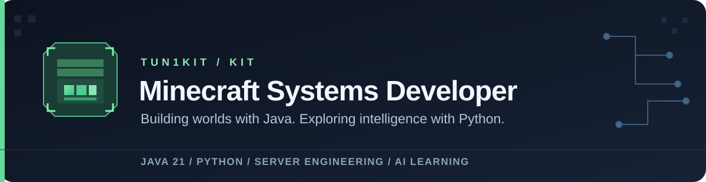

<!-- Profile README | github.com/Tun1Kit -->

  

  <strong>Developer @ <a href="https://luckyvn.com/">LuckyVN Network</a></strong> &nbsp;·&nbsp; <strong>Minecraft Systems Developer</strong> &nbsp;·&nbsp; <strong>Aspiring AI Engineer</strong>

  <a href="https://github.com/Tun1Kit?tab=repositories">Repositories</a>
  &nbsp;·&nbsp;
  <a href="https://github.com/Tun1Kit?tab=overview">Development Activity</a>
  &nbsp;·&nbsp;
  <a href="https://luckyvn.com/">LuckyVN Network</a>

---

### About me

Hey, I'm **Kit**, a Minecraft server developer from Vietnam, currently developing for **[LuckyVN Network](https://luckyvn.com/)** — one of Vietnam's well-known Minecraft server communities. I focus on **Minecraft server engineering**, Java-based gameplay systems, and developer automation with Python.

I enjoy designing maintainable server mechanics, improving development workflows, and learning how **AI engineering** can help build smarter tools and experiences.

- **Main focus:** Minecraft gameplay systems, server-side plugins, and ecosystem tooling.
- **Languages:** Java and Python.
- **Currently learning:** AI/ML fundamentals, LLM applications, and practical evaluation techniques.
- **Engineering mindset:** Build carefully, test changes, document decisions, and keep improving.

### Experience

**Minecraft Server Developer — [LuckyVN Network](https://luckyvn.com/)** · Current

Working on Minecraft server-side systems and gameplay development in a large Vietnamese Minecraft community. My engineering interests include modular Java plugins, reliable server mechanics, Python tooling, and practical AI-assisted workflows.

- Website: **[luckyvn.com](https://luckyvn.com/)**
- GitHub organization: **[LUCKYVN-NETWORK](https://github.com/LUCKYVN-NETWORK)**

### Selected work

| Project | Engineering focus |
|:--|:--|
| **Core RNG / PetRNG Tycoon** 🔒 | A Minecraft RNG/tycoon ecosystem with modular Java server plugins, progression and pet systems, gameplay interfaces, and Python-assisted workflows. |
| **Tu Tiên** 🔒 | A Minecraft progression ecosystem involving gameplay mechanics, server configuration, tooling, testing, and release documentation. |

> **Private work:** These are active private repositories. This overview intentionally describes the engineering scope without exposing source code, infrastructure, or internal operational details.

### Technologies

**Core development**

**Minecraft engineering**

**Exploring next**

### What I'm working toward

- Designing **reliable, modular Minecraft server systems**.
- Building **Python tools** that simplify development and operations.
- Exploring **AI-powered developer tools**, from prototypes to measurable, useful applications.
- Sharing more **public technical projects and write-ups** as work becomes ready to release.

---

  Build systems. Learn continuously. Ship with care. ⛏️

